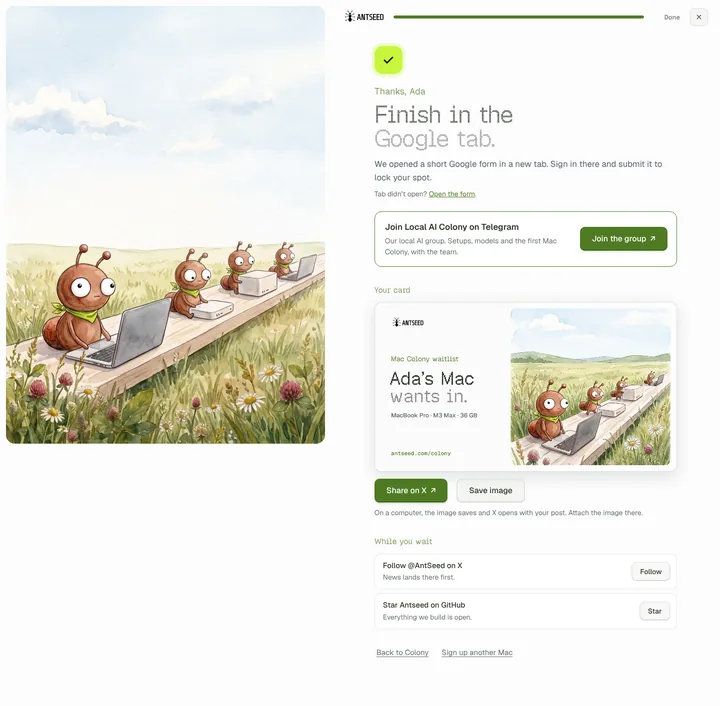
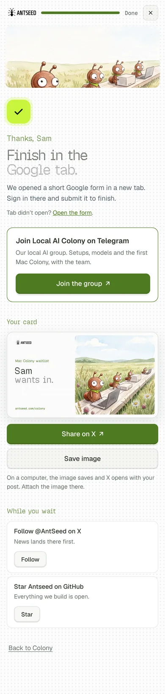
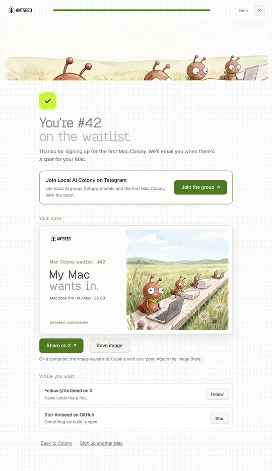
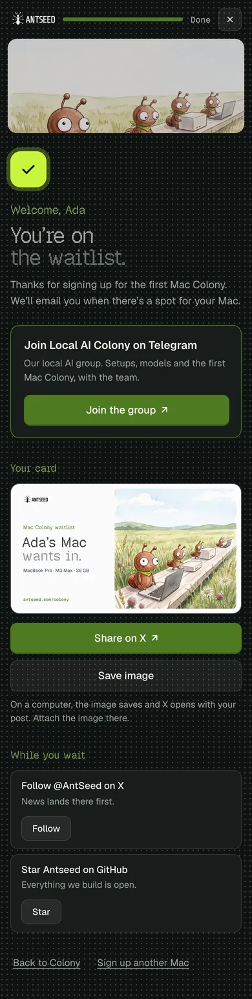
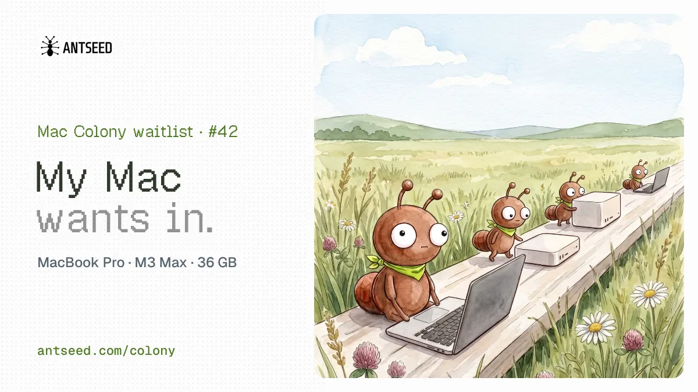
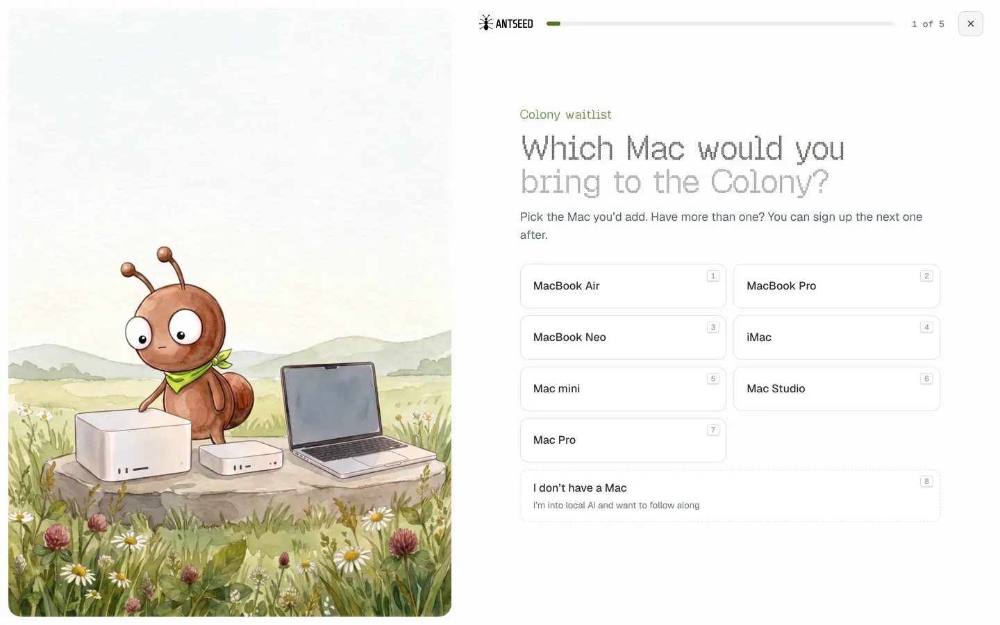

## Problem

The Colony waitlist that went live with the new site has gaps:

- Its Telegram buttons don't lead to the Colony community group, and they don't use the group's name.
- Someone without a Mac can't finish, because the form requires a chip and memory.
- The form takes one response per Google account, so nobody can sign up a second Mac, although the last step offers "Sign up another Mac".
- The share card from the earlier design is gone. After submitting, Google's thank-you note has nowhere on the site to send people.
- After signing up, nothing points people to the Local AI Colony group on Telegram.
- A post shared to X from a computer carries no picture, because X's share link can't attach one.
- Between 641 and 1279 px the Colony pages look broken in places. The join steps put a full-width painting over a narrower column, the questions and some titles break word by word, and the privacy cards shrink as the screen widens. At 320 px `/colony/` scrolls sideways.

## Change

- Every Colony Telegram button goes to the Local AI Colony group (`t.me/localai_colony`) and uses that name.
- The first question gets an "I don't have a Mac" answer. It skips the chip and memory steps, sends `No Mac` with the first name, and leaves out "Sign up another Mac".
- The sign-up copy matches what the form asks.
- `colony.json` points at a new waitlist form. It still confirms the email by Google sign-in. Chip and Memory are optional, and one account can send several responses, one per Mac. No Source field is sent.
- The last step leads with Local AI Colony on Telegram, then draws a 1200 × 675 waitlist card ("Ada's Mac wants in.", with the Mac line), with Share on X and Save image. On a phone, Share hands the image itself to the share sheet. On a computer, X opens with a post that names their Mac and links to `/colony/mac/<their Mac>/`.
- New page `/colony/joined/`, which the form's thank-you note and welcome email link to. It leads with Local AI Colony too, then draws the same card from the first name and Mac this browser kept during the sign-up.
- The welcome email's link (`#n=42&mac=…`) adds the waitlist number to the page and the card, and its Mac, so the card works on any device. The link never carries a name or an email. A Mac the sign-up doesn't offer, or a number that isn't a whole number from 1, never reaches the card.
- New static pages `/colony/mac/macbook-air/`, `/colony/mac/macbook-pro/` and so on, one per Mac the sign-up offers. Each has a 1200 × 630 card for that Mac ("My MacBook Air wants in.", under 160 KB) as its `og:image` and `twitter:image`, and sends a person on to `/colony/`. So a post on X, and a link in any app that shows previews, carries the card as its picture. A test checks that every Mac in `macs.ts` has its page and picture.
- Tablet and small-phone widths: from 641 to 959 px the join painting is as wide as the questions and centred above them. The question size fits its column at every width. "Set up your Mac" and "Built with its first members" stay one column up to 1023 px. The privacy cards keep their 480 px width. Below 360 px the side padding and button padding shrink, so nothing scrolls sideways. On phones and tablets the done-step painting shows the ants' faces. CSS only.
- The welcome email and the waitlist number come from the form's own script, outside this repo.

## Issue

- Type: bug fix (Telegram link, no-Mac answer, one response per account), plus the share card and the card page
- Touches money paths: no

No issue

## Evidence

- Test: `node --test 'src/**/*.test.ts'` in `apps/website`, 35 pass. These include `cardFacts.test.ts`, which checks that the card shows only a Mac the sign-up offers and a name of 40 characters at most, that the email link gives only a whole number and an offered Mac (never a name), that the post names the Mac and links to the page for that Mac, and that every Mac has its share page and picture. `macs.test.ts` covers the no-Mac answer.
- Typecheck and `pnpm --filter @antseed/website build` pass.
- A scripted browser run on the production build passed 69 of 69 checks. Each answer reaches the right form field. The no-Mac path sends `No Mac` and the name only. The last step and `/colony/joined/` put the Local AI Colony button before the card, and it opens `t.me/localai_colony`. The card draws at 1200 × 675. Save image downloads it. Share on X opens the post with the link to that Mac's page and downloads nothing. Each Mac's page names a large card whose picture loads, and a person opening it lands on `/colony/`. `/colony/joined/` shows the kept name and Mac and drops anything else. Every link in the welcome email and the thank-you note opens a real page. The email's card link, opened in a browser that kept nothing, shows the number and the Mac. Made-up links show no name and no made-up Mac. Every Telegram button goes to `t.me/localai_colony`. Nothing scrolls sideways on desktop or phone, in light or dark.
- A width sweep of `/colony/`, every join step (Mac and no Mac) and `/colony/joined/` (kept, and from both email links) at 320, 375, 414, 600, 700, 768, 820, 900, 1024, 1180, 1280 and 1440 px, light at every width and dark at 375, 900 and 1440: no sideways scroll anywhere, and every screenshot checked by eye.
- The live form was tested with two real sign-ups, one with a Mac and one without. Both landed with the verified email. A signed-out submit is refused.
- Before: the last step showed no card, and `/colony/joined/` didn't exist.
- After:

| Last step, desktop | No Mac, last step, phone, dark |
| --- | --- |
|  |  |

| `/colony/joined/` from the email link, another browser | `/colony/joined/`, phone, dark |
| --- | --- |
|  |  |

| The card from the email link | Which Mac, with the no-Mac answer |
| --- | --- |
|  |  |

| The picture a shared post shows (`/colony/mac/macbook-air/`) |
| --- |
|  |

- Not checked: `/colony/joined/` and `/colony/mac/…/` on antseed.com itself, which ship with this PR, and how X shows the preview, which needs those pages live. `/colony/` shows no preview on X today, likely a cached failed fetch of `og-waitlist.png`; #1764 moves that picture to a new file.

- [x] One problem only. No unrelated changes.
- [x] CHANGELOG.md updated, or this PR says it has no user-facing change.
- [x] I have read the whole diff and I am responsible for it, including any AI-written code.
