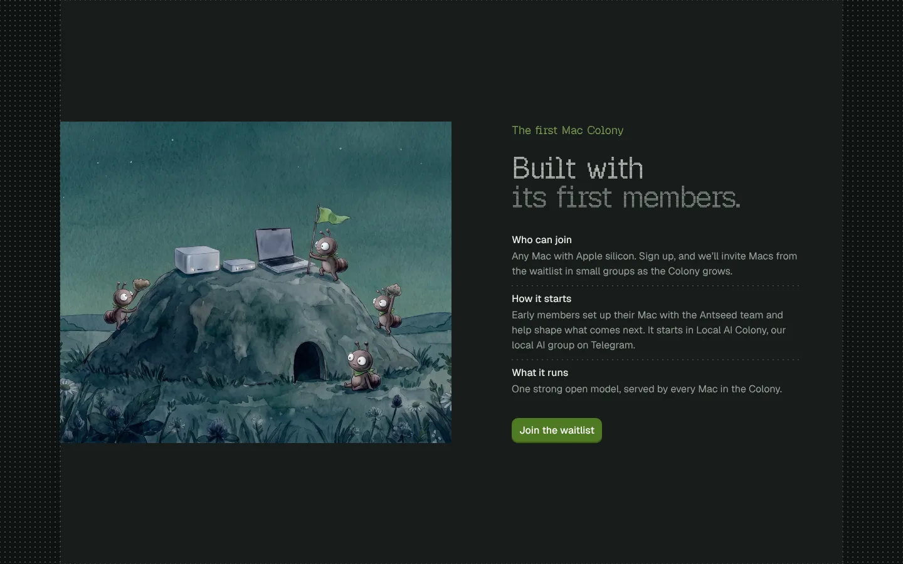
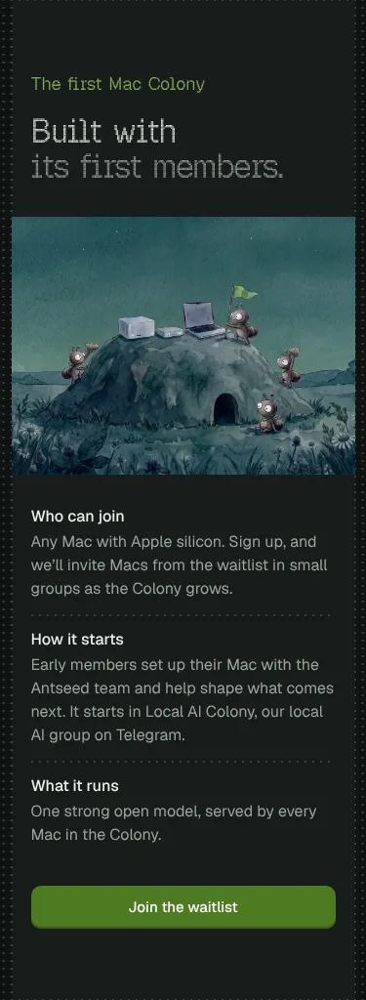
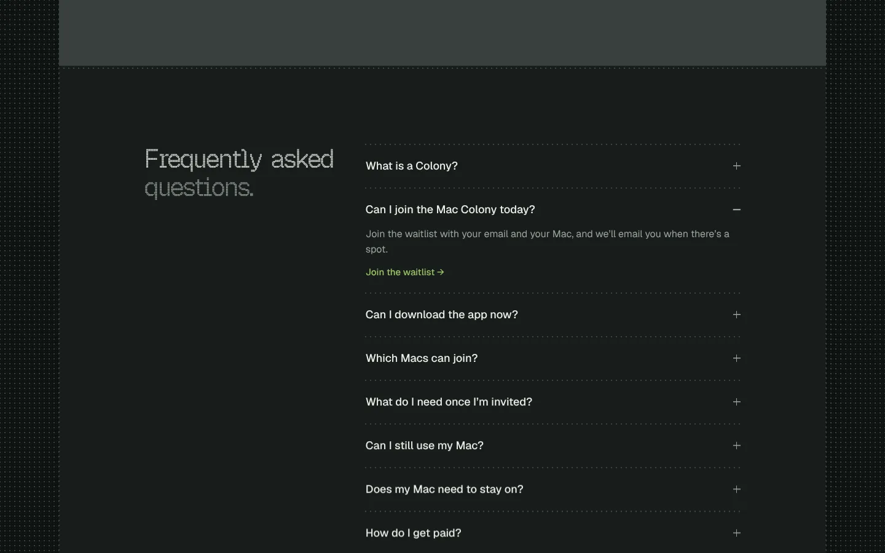

## Problem

The Colony page says "Early access is invite-only while we test." twice, under "Built with its first members." and at the start of the "Can I join the Mac Colony today?" answer. We don't want the page to say it.

## Change

- The line under "Built with its first members." is gone, along with the two style rules that only spaced it.
- The FAQ answer now reads "Join the waitlist with your email and your Mac, and we’ll email you when there’s a spot." The FAQ's structured data follows, since it is built from the same list.

## Issue

- Type: behaviour change (page copy)
- Touches money paths: no

No issue

## Evidence

- Test: `node --test 'src/**/*.test.ts'` in `apps/website`, 39 pass. Typecheck and `pnpm --filter @antseed/website build` pass.
- A browser check of `/colony/` on the production build at 320, 375, 768, 1024, 1280 and 1440 px, light and dark. The phrase appears nowhere in the page's HTML, the section's content stays inside it (one screen tall from 1200 px), and nothing scrolls sideways.
- Before: "Early access is invite-only while we test." under the title and in the FAQ answer.
- After:

| Desktop, dark | Phone, dark | FAQ |
| --- | --- | --- |
|  |  |  |

- [x] One problem only. No unrelated changes.
- [x] CHANGELOG.md updated, or this PR says it has no user-facing change.
- [x] I have read the whole diff and I am responsible for it, including any AI-written code.
