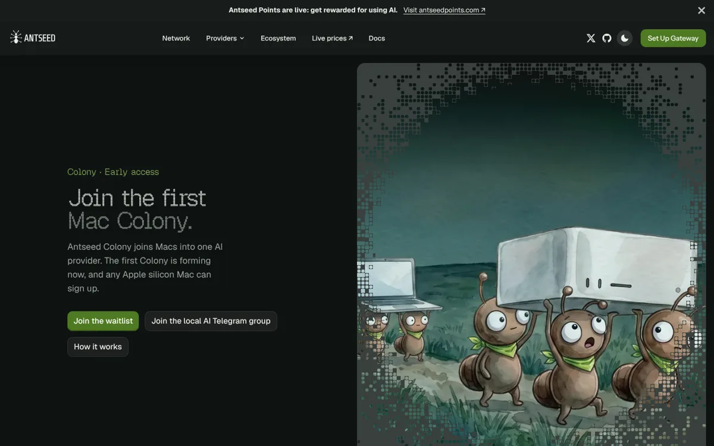
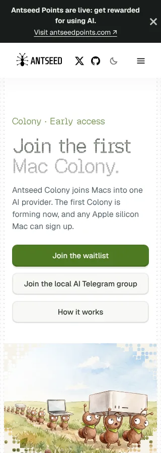

## Problem

The three Telegram buttons on `/colony/` say "Join Local AI Colony on Telegram". People reading the page don't know the group's name yet, so the label doesn't say what they are joining.

## Change

- The Telegram buttons in the hero, the path card and the join section now read "Join the local AI Telegram group". They still open `t.me/localai_colony`.
- Two comments that quote the old label are updated.
- Left as they are: the box after signing up, the welcome email and the form's thank-you note, which introduce the group by its name.

## Issue

- Type: behaviour change (button label)
- Touches money paths: no

No issue

## Evidence

- Test: typecheck and `pnpm --filter @antseed/website build` pass.
- A browser check of `/colony/` on the production build at 320, 375, 768, 1024 and 1440 px, light and dark. All three buttons show the new label on one line, open the group, and nothing scrolls sideways. At 320 px the button is 272 px wide.
- Before: "Join Local AI Colony on Telegram".
- After:

| Desktop, dark | 320 px |
| --- | --- |
|  |  |

- [x] One problem only. No unrelated changes.
- [x] CHANGELOG.md updated, or this PR says it has no user-facing change.
- [x] I have read the whole diff and I am responsible for it, including any AI-written code.
