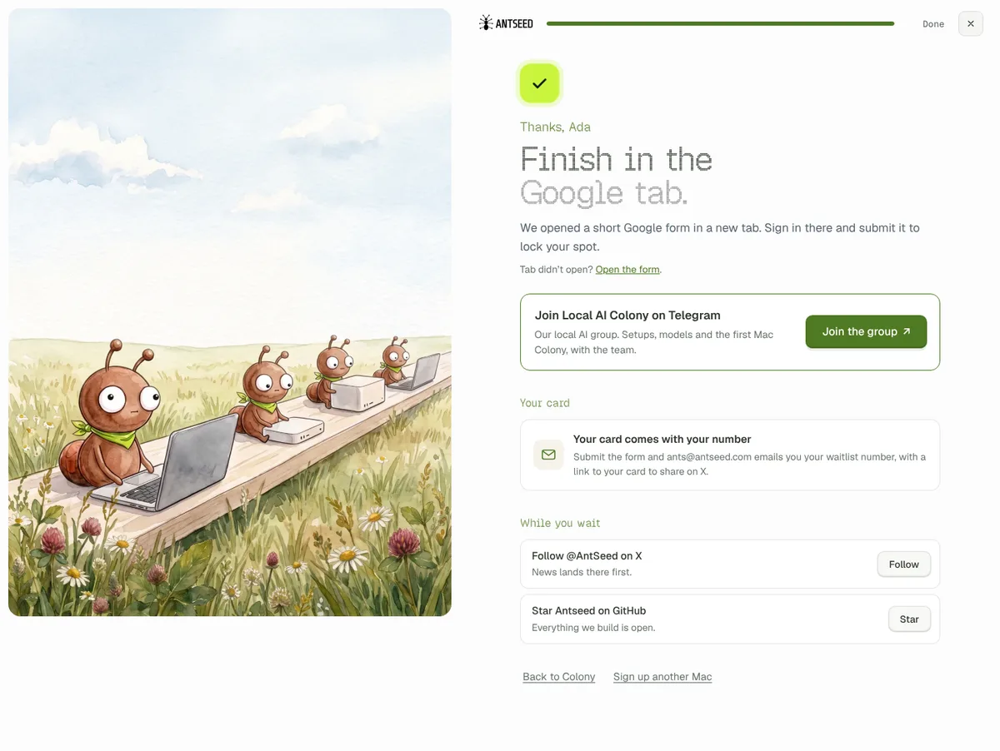
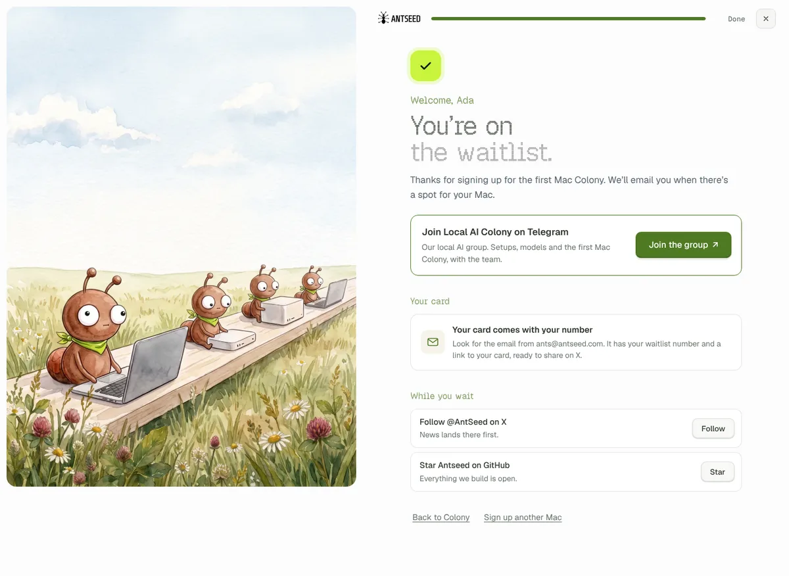
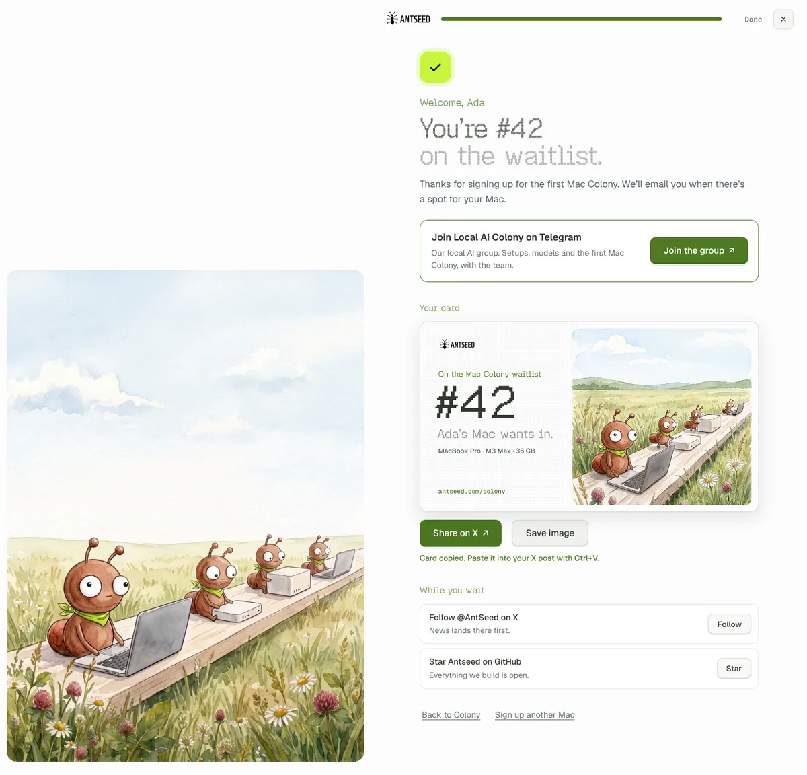
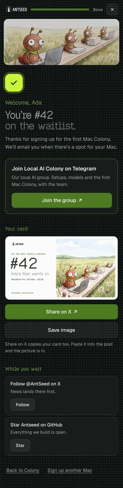
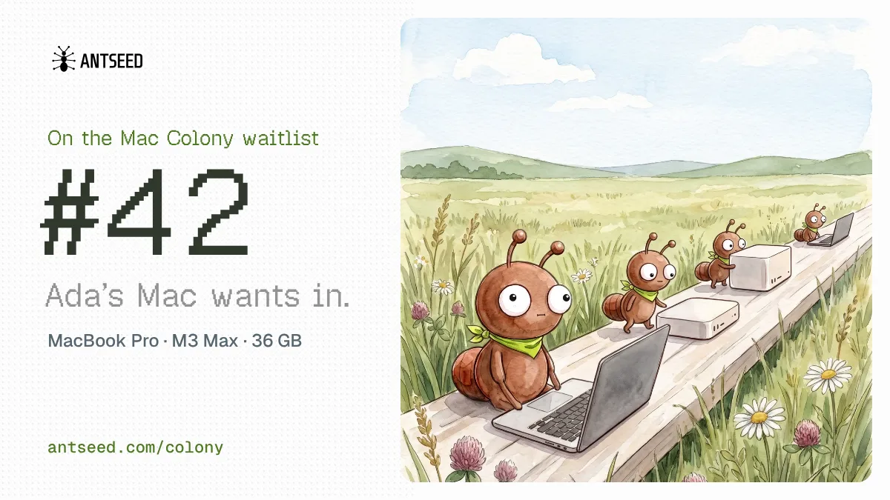
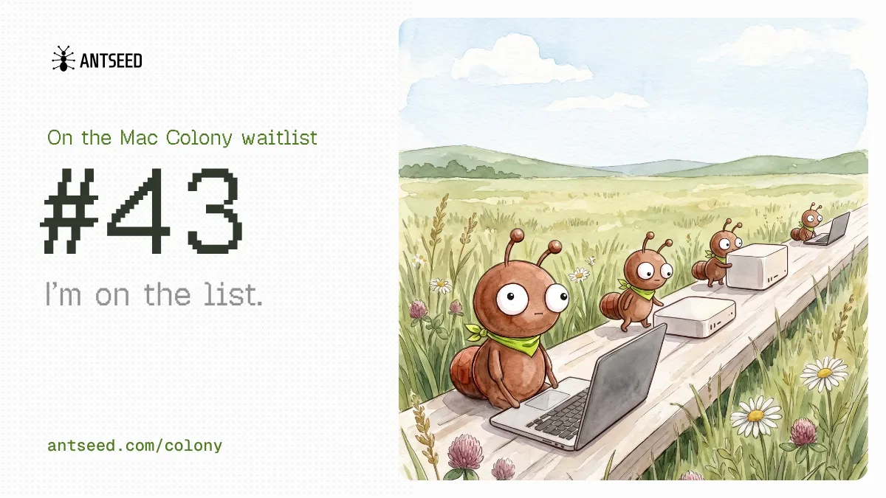

## Problem

Two problems with the Colony share card, seen after #1765 went live:

- The card people share doesn't show their spot on the waitlist. The sign-up's last step and `/colony/joined/` without the welcome email's link draw the card from the first name and Mac alone, because the number only exists once the form's script assigns it. Where the number is known (the email's link), it's a small line above the name.
- Share on X on a computer opens a post with no picture. X's post link can carry words and a link but never an image, and the link's own preview only shows once the post is up.

## Change

- The card leads with the waitlist number in large type ("#42"), then "Ada's Mac wants in." and the Mac line. Long numbers and names shrink to fit.
- The card only appears once the number is known, from the welcome email's link (`/colony/joined/#n=42&mac=…`). The sign-up's last step and `/colony/joined/` without a number show a short note instead, saying the card with their number comes in the welcome email.
- On a computer, Share on X first copies the card to the clipboard (`navigator.clipboard.write` with an `image/png` `ClipboardItem`), then opens X with the same words and link. The line under the buttons says one paste (⌘V on a Mac, Ctrl+V elsewhere) adds the picture, and after the click it says the card is copied. X opens as soon as the copy is done, or after 800 ms at most. If the browser refuses the copy, X still opens and the line says to save the image instead.
- Phones keep handing the card itself to the share sheet. Save image is unchanged.
- The form's thank-you note no longer links `/colony/joined/` and says the number and the card link come by email. That copy lives in the form's script, outside this repo, and is already updated.
- Left out on purpose: a person's own card as the link preview. That needs a server on antseed.com, and the per-Mac pages from #1765 stay as they are.

## Issue

- Type: behaviour change (the shared card and the X post on a computer)
- Touches money paths: no

No issue

## Evidence

- Test: `node --test 'src/**/*.test.ts'` in `apps/website`, 39 pass. Typecheck and `pnpm --filter @antseed/website build` pass.
- A scripted browser run on the production build (Chromium) passed 78 of 78 checks. The last step and `/colony/joined/` without a number draw no card and show the note. The email's link shows "#42" on the page and the card, with the name kept in that browser, or without a name on another device. Share on X leaves a 1200 × 675 PNG on the clipboard, opens X in about 100 ms with the same words and the link to that Mac's page, and downloads nothing. With the copy refused, X still opens and the note says to save the image. With a copy that never settles, X opens in under a second. Save image downloads the card. Every link in the welcome email and the thank-you note opens a real page. Nothing scrolls sideways on desktop or phone, light or dark.
- Checked by hand on a Mac, in a Chromium browser signed in to X, with the same build served locally. Share on X put the #42 card on the macOS clipboard (PNG, 1200 × 675) and opened X with the post text. Cmd+V in the post box attached the card as an image. Nothing was posted.
- Before: the last step drew a card with no number ("Ada's Mac wants in."), and the X post opened with no picture.
- After:

| Last step, desktop | `/colony/joined/` without a number |
| --- | --- |
|  |  |

| From the email's link, after Share on X | Phone, dark |
| --- | --- |
|  |  |

| The card | No Mac, opened on another device |
| --- | --- |
|  |  |

- Not checked: Safari and Firefox by hand. Both support writing an `image/png` `ClipboardItem`, and if either refuses, the page falls back to Save image.

- [x] One problem only. No unrelated changes.
- [x] CHANGELOG.md updated, or this PR says it has no user-facing change.
- [x] I have read the whole diff and I am responsible for it, including any AI-written code.
